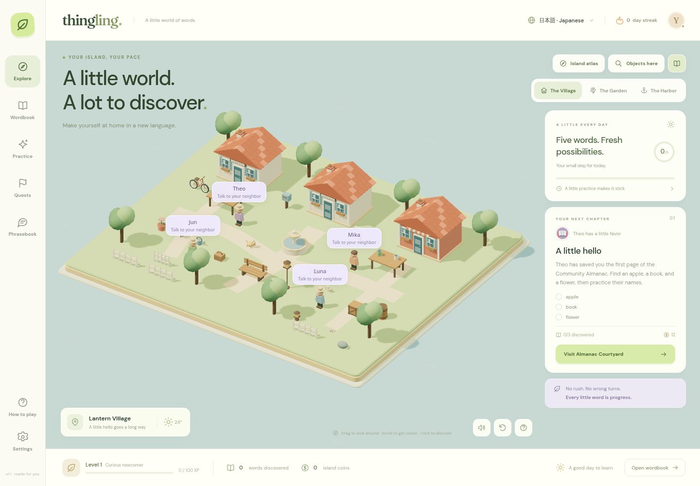

# Thing Ling

A cozy language-learning game with an explorable 3D village and twelve mission maps. Meet four neighbors, fill the Community Almanac, and make the island a little lovelier as your words take root.

**Languages:** German, Japanese, Spanish, and Mandarin Chinese. Chinese uses simplified characters and pinyin; Japanese includes romanized readings. German includes noun articles, and typed exercises accept the noun with or without its article. Progress is separate for each language.

## Play

[Download for Windows 10/11](https://github.com/ItsTheRenaissanceMan/Thing-Ling/raw/refs/heads/main/downloads/Thing-Ling-Windows.zip) · [Portable game and source](https://github.com/ItsTheRenaissanceMan/Thing-Ling/raw/refs/heads/main/downloads/Thing-Ling.zip) · [All downloads and checksums](downloads/README.md)

For Windows 10 or 11, extract **Thing-Ling-Windows.zip** and double-click **Play Thing Ling.cmd**. It opens your default browser and uses built-in Windows PowerShell to serve the game only on your own computer. Keep the small launcher window open while playing. No Node.js, Python, installation, or administrator rights are needed. The fixed local address preserves saves when you move the folder; use the same browser profile. See [Windows instructions](windows/START-HERE.txt). Native Windows execution has not been tested in this Linux workspace.

The production build is a **single portable HTML file**: `dist/index.html`. Open it in a modern desktop browser. All game geometry, code, styles, and fonts are embedded; the core game needs no server, account, API key, or internet connection. Your browser needs WebGL for the island. The wordbook, quests, conversations, and exercises remain available when 3D graphics cannot start.

If your browser restricts local HTML files, serve the folder with `python3 -m http.server 8080 --bind 127.0.0.1` and open that local port. This cloud's managed Chromium blocks `file:` navigation, so the portable build was tested through a local server, with gameplay then running offline and no separate asset requests.

To run from source, use Node.js 22.12+ or 24:

```sh
npm ci
npm run dev
```

Build the portable game:

```sh
npm run build
```

Prepare the Windows launch folder with `npm run package:windows`. Its readable PowerShell source is [windows/launcher.ps1](windows/launcher.ps1); packaging embeds that command directly in the CMD launcher without modifying execution-policy settings.

To refresh both complete ZIPs, the portable HTML, and SHA-256 checksums in `downloads/`, run `npm run package:windows` followed by `python3 scripts/package-release.py` (or `py -3 scripts/package-release.py` on a Windows development machine). Python is used only to build release archives; players do not need it. Both ZIPs include the full source, Windows files, and packaging scripts. Generated development dependencies, caches, and test outputs are excluded.

In the managed cloud environment, use the existing checkout at `/workspace/Thing-Ling`. Each cloud task is already isolated; no Git worktree is needed. If the default npm cache is read-only, use `npm ci --cache /workspace/.cache/thing-ling/npm`.



## Your first few minutes

1. Pick your learning language in the top bar. German is the initial selection.
2. Drag to look around, scroll to zoom, and click a neighbor or object. **Labels** shows translated names; **Objects here** lists every object and building part in the current map.
3. Open the **Atlas**, visit **Almanac Courtyard**, and help Theo with the apple, book, and flower. Use each object’s task button to record your work.
4. Finish the map’s word check with every answer correct, then return to Theo and hand over your work to complete the favor. Mistakes explain the answer; tasks stay saved while you retry.
5. Follow the branching café, garden, and harbor stories. All twelve favors have their own populated map. Completed locations remain available to revisit.
6. Try a conversation with a neighbor, or use the Phrasebook to practice ordering, greetings, directions, and asking for help.
7. Revisit words in Practice. Earn coins and spend them on visible island projects from the quest board.

## Implemented game

- Thirteen original low-poly 3D maps: a village hub and twelve distinct mission locations, including a tea house, bakery, café, planting terraces, citrus grove, animal sanctuary, conservatory, cove, parcel exchange, cottage, and lighthouse.
- 471 authored object placements, plus individually labelled building parts and scenery. Every rendered mesh belongs to a vocabulary object or named character. Ground spacing, tabletop supports, and actual model bounds are validated to prevent unintended overlaps.
- A travel atlas, translated labels, searchable map object directory, draggable orbit/zoom, object tooltips, and four character markers.
- 179 vocabulary words in each of four languages, organized into five categories.
- Twelve complete dependency-linked missions with distinct authored tasks, perfect word checks, explicit character handovers, persistent progress, and three visible landmark restorations. See the [campaign guide](docs/CAMPAIGN.md).
- Four three-step contextual conversations using 12 practical phrases per language. Wrong choices explain their meaning and allow retries.
- Matching, listening, and typed recall, including Japanese romanization and Mandarin pinyin.
- A spaced-review schedule: correct due reviews advance through 10 minutes, 1 day, 3 days, 7 days, and 14 days. Early extra practice keeps its existing mastery and due time; mistakes lower mastery and return after one minute.
- XP, levels, a daily discovery goal, study streaks, coins, and three purchasable cosmetic projects.
- A searchable wordbook with discovered, due, and category filters, plus mastery indicators.
- Separate automatic saves for each language, validated JSON import/export, and a confirmed per-language reset.
- Sound and motion preferences, device reduced-motion support, keyboard-accessible controls, modal focus trapping, responsive layouts, and a 3D fallback.

Streaks and daily discovery totals currently use UTC calendar days. Mastery is a game progression signal, not a certified language proficiency score.

## Audio and saved progress

Pronunciation uses an installed browser/device voice for the selected language. If no matching voice is available, the game says so and displays the written word and reading. Listening practice remains playable through that fallback; it does not claim that recorded pronunciation was supplied.

Optional speech input appears only in browsers exposing speech recognition. It requests microphone access when used, and the browser may send speech to its own recognition service. All activities also work with typing or choices.

Saves live in browser `localStorage`, under `thing-ling.saves.v1`. They do not sync between devices, browser profiles, different hosting origins, or necessarily between local HTML files. Export a backup from Settings before clearing browser storage or moving the game. No analytics or server-side storage is used.

## Validation

```sh
npm test
npm run test:e2e
npm run build
```

Unit tests exercise learning, story and mission rules, all four full campaign chains, legacy save migration, and map placement geometry. Browser tests play all twelve missions through their real UI, inspect every map’s actual rendered bounds and labels, and cover practice, conversations, language switching, mobile layouts, and saved progress. See [validation details](docs/VALIDATION.md).

Browser tests use the system Chromium at `/usr/bin/chromium`; set `CHROMIUM_PATH` for another installation. The Playwright configuration starts Vite if needed and uses a software WebGL renderer in headless environments. Test-only software-rendering flags are not required for normal play.

## Design and research status

This is an original playable first edition, with its own island, characters, story, geometry, and interface. Its cozy low-poly direction is inspired by the broad aesthetic requested by the user. It contains no extracted Noun Town assets, map, characters, music, or code.

Network access became available before publication, and [the research report](docs/RESEARCH.md) now analyzes Noun Town's official description, screenshots, release announcements, and a documented sample of real Steam reviews. It separates verified features, player reports, design proposals, and the actual delivered scope. Noun Town advertises over 1,000 words and phrases, 11 areas, and 16 characters; Thing Ling v1.1 has 179 vocabulary words per language, thirteen maps, twelve complete missions, and four characters. It does not claim equivalent commercial content, VR support, a trained pronunciation assessment system, or professionally recorded dialogue.

## Source map

| File | Responsibility |
| --- | --- |
| `src/world.js` | Map rendering, semantic labels, camera, interaction, animation, diagnostics |
| `src/props.js` | Low-poly object models, semantic parts, shared model bounds |
| `src/maps.js` | Thirteen authored maps, placements, geometry validation |
| `src/missions.js` | Physical objectives, assessments, handovers, mission progress |
| `src/data.js` | Shared vocabulary and language metadata |
| `src/learning.js` | Learning rules, reviews, session generation, save validation |
| `src/story.js` | Characters, quest graph, phrases, conversation scenarios |
| `src/main.js` | Game interface, state, audio, exercises, persistence |
| `src/style.css` | Responsive visual design and accessibility states |
| `tests/` | Unit tests and browser playtests |

Three.js, Vite, Playwright, and the single-file build plugin are open-source dependencies. DM Sans and Fraunces are included through Fontsource packages under their included font licenses. Emoji render through the player’s system font. All island geometry is generated in this repository.
