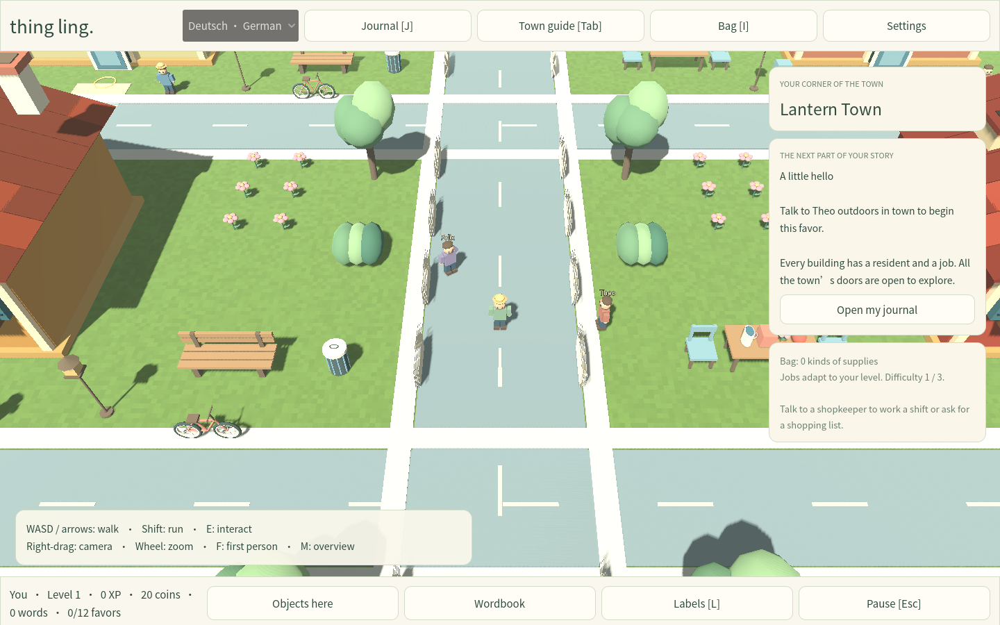

# Thing Ling

A local 3D language adventure for **Windows 10/11**. Walk through Lantern Town, enter its buildings, meet residents, learn object names, complete full-sentence missions, and work at cafés, shops and other venues.

**Languages:** German, Japanese, Spanish and Mandarin Chinese. German includes noun articles, Japanese includes romaji, and Chinese uses simplified characters with pinyin. Each language keeps its own progress.

## Play the native game — version 2.0

[Download the Windows game](https://github.com/ItsTheRenaissanceMan/Thing-Ling/raw/refs/heads/main/downloads/Thing-Ling-Windows.zip) · [Player manual](docs/NATIVE_GAME.md) · [All downloads and checksums](downloads/README.md)

Choose **Extract All** for **Thing-Ling-Windows.zip**, open the extracted **Thing Ling** folder, and double-click **Thing Ling.exe**. This is a standalone Godot game with its assets embedded. Playing needs no browser, web server, Node.js, Python, PowerShell, account, internet connection or administrator access. A 64-bit Windows PC with an OpenGL 3.3-capable graphics driver is required.



Use WASD or the arrow keys to walk, Shift to run and **E** to interact with nearby people, objects and doors. Right-drag turns the camera; the wheel zooms. **J** opens the journal, **I** the bag and **Tab** the town guide. Start by accepting **A little hello** from **Theo outdoors in the Old Village**, then follow its journal steps into Almanac Welcome Courtyard. Read the [manual](docs/NATIVE_GAME.md) for the full controls and first-mission walkthrough.

## What is in the native edition

- A connected **180×180 town**, **28 enterable buildings** and **28 distinct interiors**: **29 maps** overall. Each doorway loads its own map and every interior offers gameplay.
- **5,030 authored object placements**, including **1,304 outdoors**. The supermarket contains 373 objects, including 288 shelf products; the café contains 147. Terrain and architectural labels add further semantic instances.
- **36 residents**, 144 authored dialogue scenes, animated walking routines, local wildlife and three vehicle routes. The café, gardens, orchard, harbor, boats, bridge and lighthouse remain part of the expanded environment.
- **12 linked missions with 100 ordered stages** involving physical travel, collection, fixtures, sentence challenges, jobs and deliveries. Their map and NPC requirements matter; reference-card clicks do not complete physical objectives.
- **239 nouns** and **120 authored sentence challenges** across four languages. Language work increases through three difficulty tiers, with explanations, sentence composition and typed answers.
- Playable jobs in every interior: barista preparation, checkout, customer shopping, cooking, postal sorting, repairs, appointments, reservations, music, rhythm, sports and more. Recipe content includes **24 drinks and six foods**.
- Five-question mixed, listening and typed reviews with **10-minute, one-day, three-day, seven-day and fourteen-day** spacing. Early practice preserves mastery and due dates; incorrect retrieval returns in one minute.
- A controllable character, persistent bag, XP, levels, coins, local saves, native JSON backups and import of the earlier browser version's exported progress.
- **Objects here** lists each noun once with its instance count. Detailed repeated objects remain in the world. Each map has original local ambience; optional pronunciation uses installed system voices with written support.

See the [native manual](docs/NATIVE_GAME.md), [native validation record](docs/NATIVE_VALIDATION.md) and [word-for-word request checklist](docs/USER_REQUEST_CHECKLIST.md). The referenced mission image was not available in the conversation, so exact correspondence with that image remains unverified.

The native game and graphical renderer are tested on Linux. The Windows executable is cross-exported; physical Windows execution has not been tested in this environment. This is original game content inspired by a broad cozy low-poly aesthetic, with no extracted Noun Town assets, code, music or characters and no claim of commercial content parity. [The research report](docs/RESEARCH.md) preserves the source-based Noun Town investigation and its limits.

## Native source and rebuilding

The Godot project is **[native/](native/)**. Open it in **Godot 4.6.3** to edit or run from source. Native play does not depend on the JavaScript project. The [Windows source/build guide](native/README-WINDOWS.md) describes the export template, embedded assets and licenses.

With Python 3.11+ and Godot 4.6.3 installed:

```sh
python3 native/tools/prepare_windows_template.py
python3 native/audio/generate_audio.py
python3 native/tools/package_windows.py --output downloads/Thing-Ling-Windows.zip
```

The template preparer verifies the official archive's published SHA-256. Pass `--godot PATH`, `--template PATH` or `--output PATH` to the packager for another installation. The npm convenience command **`npm run package:windows`** runs this native export; it assumes the template and generated assets are already prepared. These tools are for development only.

| Native source | Responsibility |
| --- | --- |
| `native/scripts/main.gd` | Menus, map loading, dialogue, activities and physical interaction |
| `native/scripts/world.gd`, `player.gd`, `actors.gd`, `models.gd` | 3D environment, walking, camera, animation and models |
| `native/scripts/game_state.gd` | Campaign rules, inventory, levels and save migration |
| `native/scripts/activities.gd`, `activity_rules.gd` | Venue jobs and minigame rules |
| `native/scripts/language.gd`, `review.gd` | Sentence curriculum and spaced retrieval |
| `native/data/` | Town, residents, vocabulary, dialogue, challenges and recipes |
| `native/audio/`, `native/scripts/ambience.gd` | Original environmental sound generation and playback |
| `native/tests/` | Native data, rules, integration and UI checks |
| `scripts/generate-native-town.mjs` | Deterministic placement, route and walking-access validation |

## Earlier browser edition — version 1.1

The earlier browser edition remains available separately: [portable HTML](https://github.com/ItsTheRenaissanceMan/Thing-Ling/raw/refs/heads/main/downloads/Thing-Ling.html), [browser game and source ZIP](https://github.com/ItsTheRenaissanceMan/Thing-Ling/raw/refs/heads/main/downloads/Thing-Ling.zip), and [historical browser Windows launcher](https://github.com/ItsTheRenaissanceMan/Thing-Ling/raw/refs/heads/main/downloads/Thing-Ling-Browser-Windows.zip). Its **179 words, 13 maps and 471 placed props** describe version 1.1, not the native game's content. Its campaign and validation records are retained as [historical documentation](docs/CAMPAIGN.md) and [browser checks](docs/VALIDATION.md).

The browser source is `src/`, with JavaScript tests in `tests/`. It uses Node.js 22.12+ or 24:

```sh
npm ci
npm run dev
npm test
npm run test:e2e
npm run build
```

`npm run build` creates the historical browser edition's self-contained `dist/index.html`. To rebuild its browser-specific Windows launcher and archives, use:

```sh
npm run package:browser-windows
python3 scripts/package-release.py
```

The browser packager writes **Thing-Ling-Browser-Windows.zip** and preserves the native Windows ZIP and checksum entry. Browser saves live in `localStorage`; export through the browser edition's Settings before importing that backup into the native game. They do not transfer automatically.

In the managed cloud environment, use the existing checkout at `/workspace/Thing-Ling`; no worktree is needed. If the default npm cache is read-only, use `npm ci --cache /workspace/.cache/thing-ling/npm`.
