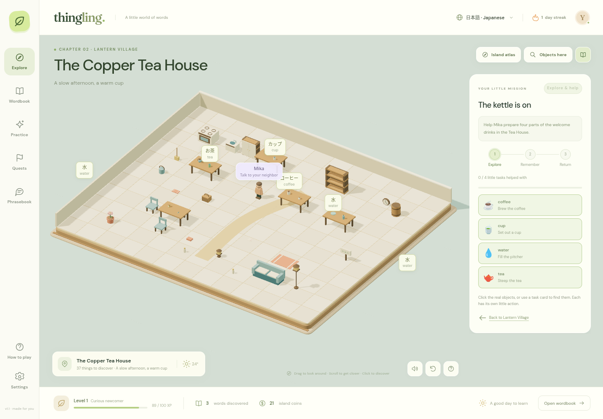
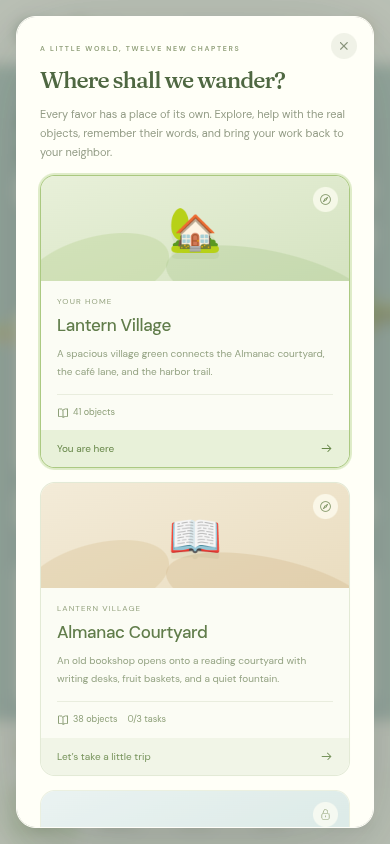
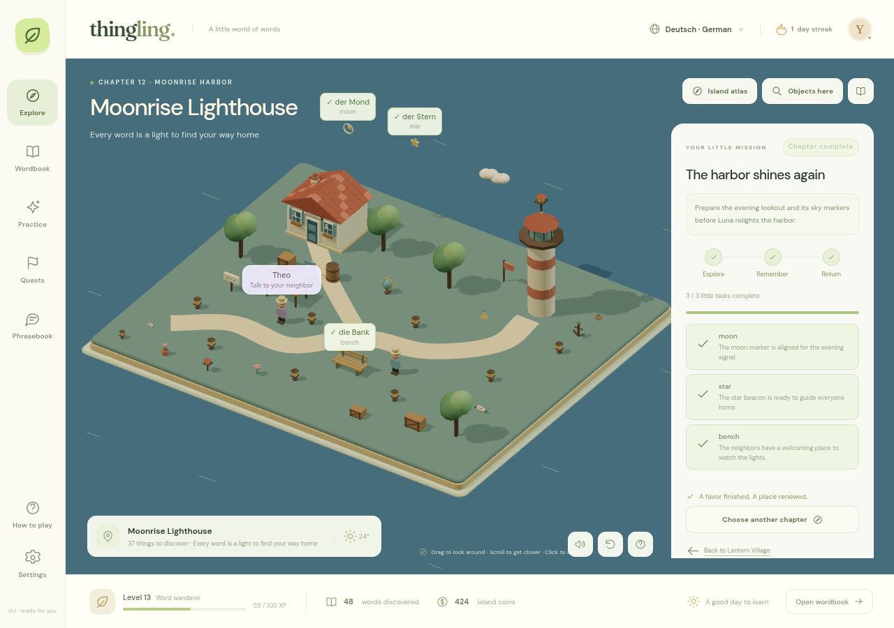

# Historical browser campaign — version 1.1

This document records the earlier browser edition. The current native game has a walkable town, building interiors, expanded story stages and venue jobs; use the [native player manual](NATIVE_GAME.md) and [native validation record](NATIVE_VALIDATION.md) for version 2.0. Counts and controls below apply only to browser version 1.1.

Thing Ling now has **12 playable missions, each with its own authored map**, plus the Lantern Village hub: **13 maps in total**. The world contains **471 placed props**. Building parts, tree parts, terrain, paths, and water add further discoverable instances beyond that placement count. The wordbook contains **179 noun entries in each of German, Japanese, Spanish, and Mandarin Chinese**.

The campaign uses 48 target words across its twelve missions. Other objects are available for discovery and review without becoming mandatory mission tasks. These are the twelve existing story chapters completed as playable places and interactions; there are no placeholder chapters in this campaign.

## Playing a chapter

1. Open **Island atlas** or a favor on the quest board and travel to an unlocked map.
2. Select its target objects in the 3D scene, the mission task cards, or **Objects here**. Use each object's specific action, such as **Brew the coffee**, **Plant the tomato**, or **Tag the bicycle**. The mission tracks these actions separately from vocabulary discoveries.
3. Once every task is complete, choose **Check my new words**. Answer the chapter's full set of questions correctly in one round. A failed round keeps your completed tasks and allows another attempt.
4. Choose **Bring it back to [neighbor]**, or select that neighbor on the map, then **Finish the little favor**. This explicit handover finishes the mission, awards its XP and coins once, and unlocks any dependent chapters.

Learning words through the wordbook or general practice is useful preparation. It does not complete the corresponding physical map tasks. The word check alone does not finish a favor or pay its completion reward. You must be in the chapter's map to perform its tasks, pass its mission check, and hand it over.

Actions use contextual buttons with individual instructions, completion messages, and visible completed-object feedback. They are authored tasks; the campaign does not implement freeform object dragging, a cooking simulation, or plant-growth timers.

## Missions and maps

“Required favors” means completed handovers, not simply discovered words. Prop counts below are authored placements; generated structural and terrain parts are additional.

| Mission and map | Neighbor | Authored tasks and target vocabulary | Required favors | Placed props |
| --- | --- | --- | --- | ---: |
| **A little hello** — Almanac Courtyard | Theo | **Collect:** pick an **apple**, open the **book** containing the Almanac, and press a **flower** for its first page. | None | 38 |
| **The kettle is on** — The Copper Tea House | Mika | **Serve:** brew **coffee**, set out a **cup**, fill the **water** pitcher, and steep **tea** for the welcome tray. | A little hello | 37 |
| **The breakfast club** — Sunrise Bakery | Mika | **Prepare:** slice **bread**, prepare an **egg**, pour **milk**, and portion **cheese** for the neighbors' breakfast. | The kettle is on | 36 |
| **A place at the table** — Lantern Café | Mika | **Arrange:** set the **table**, arrange a **chair**, switch on the **lamp**, and set the **clock** for reopening. | The breakfast club | 37 |
| **The first seedlings** — Seedling Terraces | Jun | **Plant:** tend the **tree**, sow **carrot** seeds, plant a **tomato**, and settle a **strawberry** plant into its bed. | A little hello | 35 |
| **Colors in the orchard** — Citrus Grove | Jun | **Harvest:** gather a **banana**, pick an **orange** and a **lemon**, and record a **butterfly** in the pollinator notes. | The first seedlings | 35 |
| **Small island neighbors** — Willow Sanctuary | Jun | **Care:** feed the **cat** and **dog**, leave seeds for the **bird**, and clear their resting **stone**. | Colors in the orchard | 36 |
| **A garden under the sky** — Skyglass Conservatory | Jun | **Observe:** record the **sun**, measure **rain**, note the **cloud** cover, and sketch the **mountain** for the garden field notes. | Small island neighbors | 34 |
| **Down by the water** — Driftwood Cove | Luna | **Survey:** inspect the **boat**, record a **fish**, inspect a **shell**, and check the **bridge** before visitors arrive. | A little hello | 35 |
| **The lost-and-found shelf** — The Parcel Exchange | Luna | **Sort:** tag the **bicycle**, **hat**, **bag**, **shoe**, and **umbrella** so their owners can reclaim them. | Down by the water | 35 |
| **A homecoming parcel** — Hearth Cottage | Theo | **Deliver:** bring the parcel to the **house**, check the **door**, open the **window**, prepare the **key**, and make the **bed**. | The lost-and-found shelf | 35 |
| **The harbor shines again** — Moonrise Lighthouse | Luna | **Light:** align the **moon** marker, set the **star** beacon, and prepare the lookout **bench** for the evening celebration. | A homecoming parcel **and** A place at the table **and** A garden under the sky | 37 |

Lantern Village contains the remaining **41 placed props** and the four neighbors. It is always available as the hub.

Completing **A little hello** opens the café, garden, and harbor branches. Those branches can be pursued in any order. **A place at the table** restores the café, **A garden under the sky** restores the community garden, and **The harbor shines again** restores the harbor after all three branches reach its prerequisites. Completed maps remain available to revisit; repeat visits cannot claim the mission reward again.

## Discoverable objects and spacing

Every placed prop has a vocabulary ID with translations in all four languages. Rendered building details and tree details also have semantic labels: for example, a house's roof, wall, chimney, door, and windows, or a tree's trunk and leaves. Terrain, room floors and tiles, paths, and water carry labels too. Repeated geometry belonging to one recognizable object shares its noun rather than creating a separate vocabulary word for every polygon.

**Objects here** provides the current scene's searchable inventory, including generated parts when 3D is available. Selecting an entry focuses its object and opens its word card. The label toggle shows object labels where they fit; hover labels and the inventory keep objects accessible when floating labels would collide on screen. The wordbook exposes all 179 entries independently of the current map. Browser voices provide optional pronunciation, with text and readings available when a matching voice is missing.

Maps use explicit coordinates, shared model footprints, and support relationships. Placement validation checks bounds, prop intersections, NPC clearance, valid labels, and the presence of every chapter target. A cup resting on its table or a window mounted in its wall is an intentional support relationship; unrelated props and sibling tabletop items are checked against each other. Runtime diagnostics also inspect rendered model bounds. These checks cover the authored layout rather than user-editable building placement.

If WebGL is unavailable, the scene inventory falls back to the map's placed objects and all required mission targets. The generated 3D structural details are represented in the full wordbook.

## Saves and language independence

Progress is saved automatically in the same browser storage used by the first edition, under `thing-ling.saves.v1`. Each language keeps its own discoveries, mastery and review schedule, XP, coins, quests, conversations, projects, current map, and mission task records. Switching language loads that language's map and campaign state; completing a German favor does not complete its Japanese, Spanish, or Chinese counterpart.

Existing version-one saves upgrade without a reset. Their learned words, quest completions, conversations, purchased projects, rewards, streaks, and settings are retained. Missing mission records start empty and a missing map starts at Lantern Village. Previously completed quests remain complete and their maps can be revisited without replaying tasks or receiving rewards twice. An unfinished legacy quest still needs its new map tasks, even if all its words were already learned.

New mission records store completed target actions, whether the assessment was passed, and whether the mission was submitted. Imports validate map IDs, mission IDs, target words, discovery records, assessment prerequisites, and handover consistency. An imported current map whose prerequisites are absent safely returns to the hub. Malformed records are rejected instead of partially overwriting a save.

Use **Settings → Export progress** to back up all four languages before clearing browser data, changing browser profiles, or moving to another hosting origin. There is no cloud save synchronization. Chinese uses simplified characters and pinyin; Japanese includes romanized readings. The campaign and its task instructions use English, with the object vocabulary and exercises in the selected learning language.

## Mission views

## Source of the campaign

The chapter graph and rewards are defined in [`src/story.js`](../src/story.js), map layouts in [`src/maps.js`](../src/maps.js), authored interactions and mission phases in [`src/missions.js`](../src/missions.js), vocabulary in [`src/data.js`](../src/data.js), and save migration in [`src/learning.js`](../src/learning.js). The main game connects those rules to the atlas, scene inventory, task cards, word checks, and neighbor handovers.
