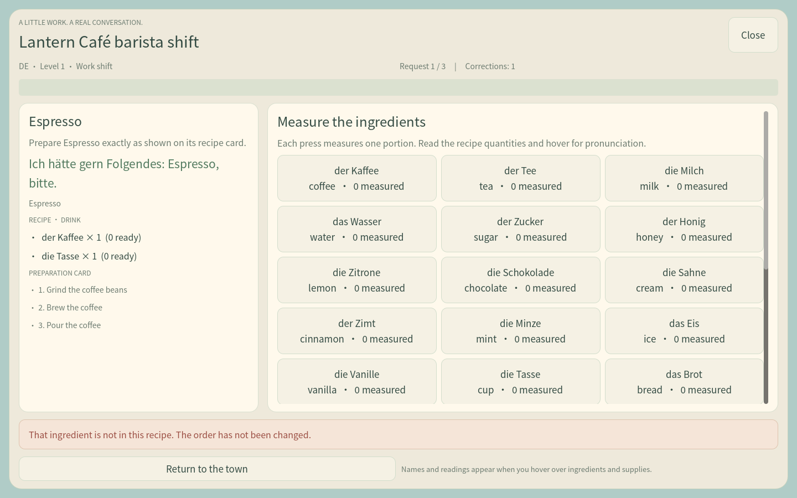
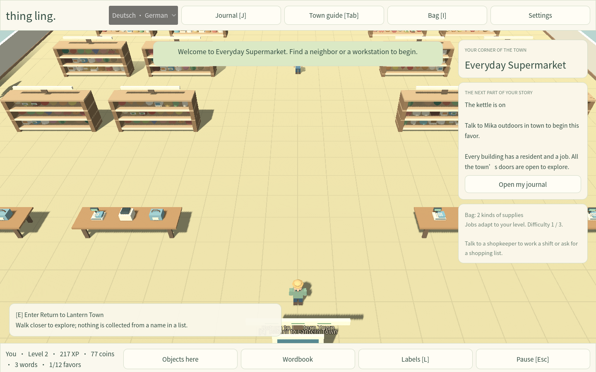
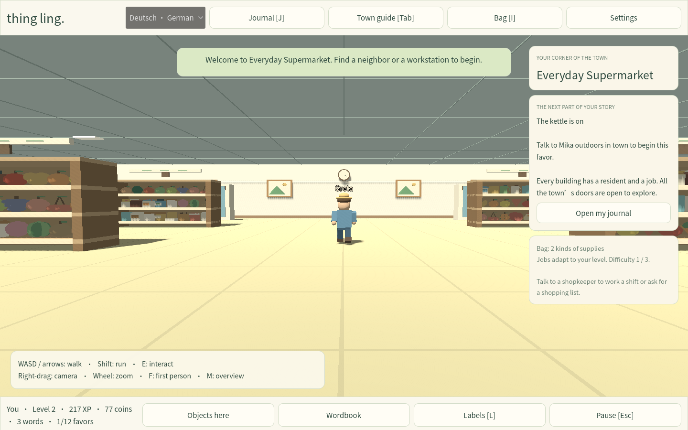

# Playing the native Windows edition

Extract the Windows ZIP into a normal folder, then double-click **Thing Ling.exe**. This edition is a local Godot game: its executable includes the maps, models, vocabulary, font and environmental audio. Playing requires no browser, server, account, internet connection, Godot installation, Node.js or Python. It targets 64-bit Windows 10/11 with an OpenGL 3.3-capable graphics driver.

Choose **German, Japanese, Spanish or Chinese**, give your character a name, choose a jacket, and start walking. Each language has its own discoveries, bag, story, work history and review schedule. Continue returns to the saved map and position.


## Getting around and beginning the story

| Control | Action |
| --- | --- |
| WASD or arrow keys | Walk relative to the camera |
| Shift | Run |
| E | Interact with a nearby person, object or doorway |
| Right mouse button + drag | Turn the camera |
| Mouse wheel | Zoom |
| M | Toggle the overhead overview |
| F | Toggle first-person view |
| Home | Reset the camera |
| J | Open the journal |
| I | Open your inventory |
| Tab | Open the town guide |
| L | Toggle object labels |
| Esc | Close a panel or open the pause menu |
| F5 | Save now |
| F11 | Toggle fullscreen |
| Space | Tap a beat when an activity requests it |

Start with **Theo in the Old Village, outdoors in town**, near the starting square. Stand beside him, press E, and choose **“I’ll help — accept this favor”** for *A little hello*. The Theo inside the Almanac Courtyard is part of the later conversation; accepting the first assignment happens in town.

Open the journal with J to read the next ordered objective. Use Tab to find **Almanac Welcome Courtyard**, mark its entrance, then walk there and press E at the door. Each entrance opens a loading screen and a distinct interior. Every interior has a return exit.

For the first favor, gather an apple, a flower and the community book inside the courtyard. Walk close to the actual object and press E, then use its **Pick up these items** button. Talk to Theo inside when the journal requests the borrowing sentence, help Ada catalogue discoveries and prepare the welcome packet, and finally return through the exit to hand the book to **Theo in town**. The next favors open as you finish their prerequisites.

The 12 favor chains contain **100 ordered stages**. They combine conversations, travel, collecting supplies, using fixtures, complete-sentence challenges, venue work and deliveries. A wordbook lookup cannot complete a physical task. If a task appears stuck, check its required map, current stage, quantity and recipient in the journal before repeating it.

The town guide marks entrances and shows districts; it does not move your character. The Old Village, Market Square, Civic Quarter, Lantern Quarter, Garden Terraces, Hearth Lane and Harbor Boardwalk are connected by streets. Cars and a bus follow three traffic routes. Residents have animated movement routines; the gardens include animals, and the waterfront retains piers, boats, the stone bridge and lighthouse.

## Discoveries, conversations and practical work

**Objects here** lists each noun **once**, followed by how many instances are in the current map. Search accepts English, the target-language spelling or its reading. Repeated flowers, groceries and furniture remain in the world; grouping the list does not remove their physical instances. A list entry opens a reference card. Walk over and press E to discover, inspect, collect or use a real instance.

The wordbook contains **239 nouns**. German cards include articles; Japanese cards include romaji; Chinese cards include pinyin. Native spelling and supported readings work in typed exercises. Pronunciation uses installed system voices when available; written readings remain usable offline without a voice installation. Environmental audio is atmosphere, rather than a pronunciation recording.

All **36 named residents** have authored conversation content: **144 dialogue scenes** across introductions, practical exchanges and follow-up situations. Conversations show the target language and English support, offer responses, and connect to sentence practice or favors. The core curriculum has **120 authored sentence challenges**: 72 campaign challenges and 48 additional venue challenges.

Difficulty grows with your level:

| Difficulty | Player levels | Language work |
| --- | --- | --- |
| 1 | 1–4 | Greetings, everyday requests and whole-sentence choices |
| 2 | 5–8 | Quantities, locations, sequences, explanations and substitutions; arrange or type sentences |
| 3 | 9 onward | Conditions, indirect questions, agreement and polite negotiation |

Grammar feedback explains the intended form and lets you retry. Japanese and Chinese challenges accept the authored reading as an alternative to native script. These are structured language exercises with authored answers, not unrestricted AI conversation or microphone-based pronunciation assessment.

Every interior offers a playable job through a nearby resident’s **Work a shift** option. Work uses choices, quantities, ordered operations, sentence composition, calculations, musical notes, rhythm or other venue-specific tasks. Finish the whole shift to receive its result and rewards. Work can be replayed as difficulty increases.

### Café, kitchen and supermarket



Café and kitchen content includes **30 recipes: 24 drinks and six foods**. Drinks include espresso, americano, cappuccino, flat white, mocha, iced coffee, flavored lattes, several teas, hot chocolate and fruit milks. The food recipes are toast, cheese sandwich, omelette, salad, soup and pasta.

Read the customer’s full request and complete its language challenge. The recipe card gives the required portions and preparation sequence. Click an ingredient once per portion; ingredient tooltips show its native spelling, reading and English meaning. Then use the equipment buttons in recipe order: grinding, brewing, heating, frothing, pouring, mixing or garnishing as required. Incorrect or extra ingredients and out-of-order operations give feedback. Serve only after preparation is complete. Different café, tea-house, bakery and restaurant shifts have different orders. Completed shifts rotate their menus, making all 24 drinks and six foods available over repeated visits; higher tiers add longer requests and more demanding grammar.



At **Everyday Supermarket**, ask Greta for either a checkout shift or a customer shopping trip.

- **Checkout work:** respond to each customer, scan each product the requested number of times, check the receipt and enter the change in **cents**. A three-customer shift increases quantities and basket complexity at higher difficulty.
- **Customer shopping:** take the list and budget, leave the counter, walk the aisles and collect the actual shelf products into your bag. Return to Greta to check out. Higher levels introduce unavailable products and substitutions. Scan the physical items you brought and enter the exact payment in cents; the basket must fit the budget. Opening the checkout interface does not supply the groceries.



### The 28 interiors

Each row below is a separately loaded map with a local activity, not an unbuilt destination. The 12 original favor destinations are included among them.

| Interior | Playable work |
| --- | --- |
| Almanac Language School | Introductions, polite requests and explaining a plan in sentences |
| Willow Community Clinic | Prioritize arrivals, book appointments and select appropriate supplies |
| The Turning Page Library | Return books, issue loans and organize reservations |
| Museum of Everyday Wonders | Catalogue objects, check exhibit dates and follow conservation procedures |
| Moonflower Night Market Club | Timed rhythm patterns, dance directions and guest-desk decisions |
| Starlight Picture House | Reserve adjacent or accessible seats; calculate tickets and change |
| Resonance Music Studio | Play note sequences, keep time and prepare a recording |
| Windmill Recreation Hall | Warm-up sequences, passing patterns and paced coordination |
| Almanac Welcome Courtyard | Record discoveries, arrange shelves and assemble a welcome packet |
| Everyday Supermarket | Customer checkout and a physical shopping-list/budget mode |
| The Copper Pot Restaurant | Ingredient quantities, ordered cooking steps and meal service |
| Lantern Town Post Office | Sort addresses and calculate local or international postage |
| The Copper Tea House | Prepare and serve complete tea and coffee orders |
| Sunrise Bakery | Make breakfast recipes from ingredients and serve orders |
| The Original Lantern Café | Barista orders, ingredient measurement and equipment sequences |
| Cornerstone Community Bank | Exact denominations, exchanges and balance calculations |
| Jun’s Potting Greenhouse | Prepare growing beds, care for tomatoes and harvest strawberries |
| Citrus Grove Farm Shop | Grade fruit, assemble harvests and plan pollinator routes |
| Willow Animal Sanctuary | Feed animals, prepare a bird station and follow dog-care steps |
| Skyglass Conservatory | Read rain gauges, classify clouds and use a planting forecast |
| The Brass Finch Workshop | Assemble a shelf, repair a bicycle wheel and calculate an estimate |
| The Green Lantern Inn | Handle reservations, check-in and check-out |
| Thread and Thimble Atelier | Choose outfits, measure alterations and organize a fitting |
| Hearth Cottage | Prepare a welcome parcel, make a comfortable bed and inspect the home |
| Driftwood Cove Boathouse | Inspect moorings, balance cargo and identify shore wildlife |
| The Parcel Exchange | Verify ownership, sort lost property and process an unclaimed bicycle |
| Lantern Central Station | Choose routes, calculate connections and compare fares |
| Moonrise Lighthouse | Prepare a lantern, read navigation signals and organize the evening watch |

## Remembering words and keeping your progress

Open the wordbook and choose **Spaced review — mixed**, **Listen and recognize** or **Type what you remember**. You can also practice one discovered word from its card. A session contains five questions drawn only from personal discoveries, with due words first. A small collection may repeat a word within the session.

Correct due retrievals advance mastery through **10 minutes, one day, three days, seven days and fourteen days**, capped at mastery five. Correct early practice earns effort rewards while preserving mastery and the scheduled due date. A wrong answer lowers mastery by one, without going below zero, and returns the word in one minute. Repeated questions cannot advance the same future-due word again; grading one answer repeatedly cannot repeat its reward. Each graded answer is saved immediately, including when you leave a session early.

Settings control ambience, volume, fullscreen, character name and jacket. Every map has its own local environmental sound profile, including quiet indoor spaces, café preparation, the station, nightlife and waterfront. Default ambience volume is 30%.

F5 saves manually; normal gameplay also saves discoveries, work and story progress. The Windows save folder is normally:

```text
%APPDATA%\Godot\app_userdata\Thing Ling — A Town of Words\
```

Keep that folder when replacing the executable with a newer release. **Export all four language saves** creates a portable JSON backup. **Import a native or older browser backup** accepts native version-2 backups and the earlier Thing Ling version-1 browser export. Older discoveries, mastery/review dates, XP, coins and completed favors migrate; new native walking/inventory fields receive native defaults. Import replaces only the languages contained in the file, after validation and confirmation. Export first if you want to retain both adventures. Starting a language again clears only that language.

## Content, source and verification

The authored content includes **29 maps**, **28 enterable buildings**, **5,030 explicitly placed objects** and **36 resident definitions**. The connected 180×180 town contains 1,304 of those placements. Interiors contain 103–373 placements each; the supermarket has 288 shelf-product placements among its 373 objects. The café contains 147 objects and the library 261. Semantic terrain and architectural labels are additional renderer records.

The deterministic town generator checks bounds, three-dimensional prop intersections, shelf support, clear entrances/spawns, NPC and traffic routes, and connected walking access. Intentional support relationships—products on shelves, fixtures on buildings, piers at the shoreline—are declared explicitly. Native data and gameplay tests also verify required mission items, map transitions, language content and review rules.

The source project is [native/](../native/). Open it with **Godot 4.6.3**, or follow [the native Windows build instructions](../native/README-WINDOWS.md). The earlier browser project remains separate. This native edition uses original procedural environments and the repository’s language material; it does not claim commercial-game content parity.

The game and renderer have been exercised on Linux, including graphical Xorg runs. The Windows executable is cross-exported; execution on a physical Windows PC remains unverified in this environment. Exact correspondence with the mission image mentioned in the request also remains unverified because that attachment was not available to inspect.
